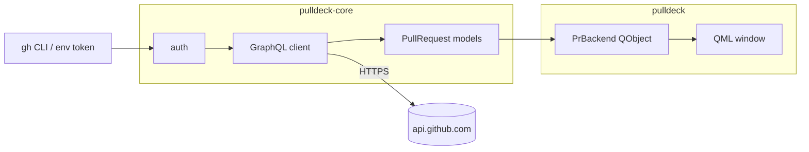

<div align="center">

# pulldeck

**Keep track of your GitHub pull requests from a native desktop window.**

[](https://github.com/bootswithdefer/pulldeck/actions/workflows/ci.yml)
[](https://github.com/bootswithdefer/pulldeck/actions/workflows/audit.yml)
[](https://github.com/bootswithdefer/pulldeck/releases)
[](LICENSE)
[](Cargo.toml)
[](https://www.qt.io/)

</div>

> **Status:** early. pulldeck currently lists your open PRs; notifications, history and a tray
> icon are on the [roadmap](#roadmap).

## Features

- **Your open PRs at a glance**: title, repo, number, draft flag and last update.
- **Review and CI badges**: approved, changes requested, needs review, CI passing, failing or running.
- **Click to open** any PR in your browser.
- **Auto-refresh** every 60 seconds, plus a manual refresh button.
- **Zero-config auth**: uses `GH_TOKEN`, `GITHUB_TOKEN` or your existing `gh auth login`.
  Tokens are never stored by pulldeck.
- **Native look**: Qt 6 with the Fusion style, which follows your KDE colour scheme.

## Install

### From source

Requirements: Rust 1.99+, Qt 6 (base and declarative) and the [GitHub CLI](https://cli.github.com/).

```bash
# Arch
sudo pacman -S qt6-base qt6-declarative github-cli
# Debian / Ubuntu
sudo apt install qt6-base-dev qt6-declarative-dev libgl1-mesa-dev \
  qml6-module-qtquick-controls qml6-module-qtquick-layouts qml6-module-qtquick-templates

git clone https://github.com/bootswithdefer/pulldeck
cd pulldeck
cargo install --path crates/pulldeck
```

### Pre-built binaries

Tagged releases attach a Linux x86_64 tarball (needs Qt 6 installed) on the
[releases page](https://github.com/bootswithdefer/pulldeck/releases).

## Usage

```bash
gh auth login      # once, if you have not already
pulldeck
```

Set `RUST_LOG=pulldeck=debug` for verbose logs. To use another Qt Quick style, set
`QT_QUICK_CONTROLS_STYLE` (default `Fusion`).

Just want the data without the UI?

```bash
cargo run -p pulldeck-core --example list
```

## How it works



| Crate | Role |
| --- | --- |
| [`pulldeck-core`](crates/pulldeck-core) | Auth, paginated GraphQL search, models. No UI dependency, unit-tested. |
| [`pulldeck`](crates/pulldeck) | Qt/QML app built with [cxx-qt](https://github.com/KDAB/cxx-qt). Network work runs on a tokio runtime and results are queued back to the Qt thread. |

## Roadmap

- [ ] Review-requested tab
- [ ] Desktop notifications (review requests, CI failures, approvals)
- [ ] System tray icon with attention state
- [ ] Merged/closed history
- [ ] Settings and filters (config in `~/.config/pulldeck/`)
- [ ] Packaging: AUR, Flatpak

## Development

```bash
just check   # rustfmt, clippy -D warnings, tests
just run
```

See [CONTRIBUTING.md](CONTRIBUTING.md) and [CHANGELOG.md](CHANGELOG.md).

## License

[MIT](LICENSE)
