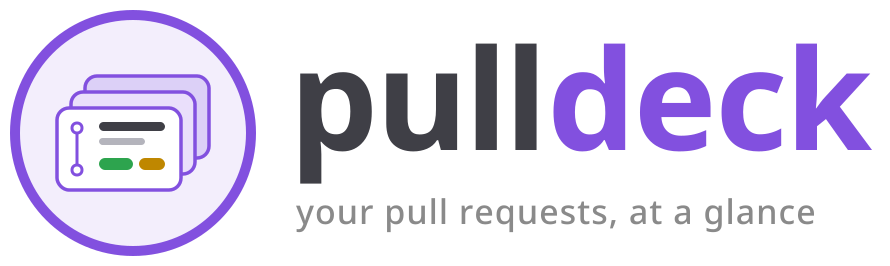
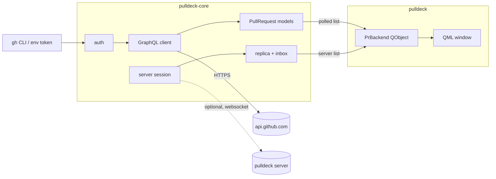

<div align="center">



**Keep track of your GitHub pull requests from a native desktop window.**

[](https://github.com/bootswithdefer/pulldeck/actions/workflows/ci.yml)
[](https://github.com/bootswithdefer/pulldeck/actions/workflows/audit.yml)
[](https://github.com/bootswithdefer/pulldeck/releases)
[](https://crates.io/crates/pulldeck)
[](LICENSE)
[](Cargo.toml)
[](https://www.qt.io/)

</div>

> **Status:** early. pulldeck lists your open PRs on its own. With an optional pulldeck server it
> also gets live updates and lets you nudge, message and ask teammates for reviews. More is on the
> [roadmap](#roadmap).

## Features

- **Your open PRs at a glance**: title, repo, number, draft flag and last update.
- **Review and CI badges**: approved, changes requested, needs review, CI passing, failing or running.
- **Click to open** any PR in your browser.
- **Auto-refresh** every 60 seconds, plus a manual refresh button.
- **Zero-config auth**: uses `GH_TOKEN`, `GITHUB_TOKEN` or your existing `gh auth login`.
  pulldeck never stores your GitHub token.
- **Works on its own**: no server needed. It polls GitHub itself, retrying when GitHub's search
  times out.
- **Optional pulldeck server**: sign in from the toolbar (GitHub's device flow; the app never sees
  your GitHub token, and the session token lives in your OS keyring) for live updates, an inbox,
  and request review, nudge and message actions on the pull requests the server can see.
  Pull requests it cannot see (for example in an organisation that has not installed its GitHub
  App) keep being polled and are merged into the same list.
- **Review requested tab** lists open pull requests where GitHub asks you personally for a
  review (not through a team), polled together with your own.
- **History tab** with your 50 most recently merged or closed pull requests.
- **Tray icon** that turns orange when something is waiting; closing the window hides it there.
- **Desktop notifications** for things other users send you (review requests, nudges, messages)
  and for review requests that appear on GitHub between polls, shown as they arrive. Your own pull
  requests also notify when their checks start failing, or when they are approved or get changes
  requested. Turn them all off with `notifications = false` in `~/.config/pulldeck/config.toml`.
- **Presence is opt-in**: telling others which PR you are viewing is off unless you turn it on.
- **Native look**: Qt 6 with the Fusion style, which follows your KDE colour scheme.

## Install

### From crates.io

Requirements: Rust 1.99+, Qt 6 (base and declarative) and the [GitHub CLI](https://cli.github.com/).
Qt is compiled against at install time, so the development packages are needed.

```bash
# Arch
sudo pacman -S qt6-base qt6-declarative github-cli
# Debian / Ubuntu
sudo apt install qt6-base-dev qt6-declarative-dev libgl1-mesa-dev \
  qml6-module-qtquick-controls qml6-module-qtquick-layouts qml6-module-qtquick-templates

cargo install pulldeck
```

### From source

With the same requirements:

```bash
git clone https://github.com/bootswithdefer/pulldeck
cd pulldeck
cargo install --path crates/pulldeck
```

### With Nix

The flake pins Qt 6 and Rust, so nothing else needs installing (flakes must be enabled):

```bash
nix run github:bootswithdefer/pulldeck     # build and run
nix build github:bootswithdefer/pulldeck   # binary in ./result/bin/pulldeck
```

### Pre-built binaries

Tagged releases attach a Linux x86_64 tarball (needs Qt 6 installed) on the
[releases page](https://github.com/bootswithdefer/pulldeck/releases).

## Usage

```bash
gh auth login      # once, if you have not already
pulldeck
```

To use a server, click **Sign in…** and enter its address (`https`, or `http` only for
`localhost`). Signing out returns to polling only. The server is a separate project; see
[CONTRIBUTING](CONTRIBUTING.md#developing-against-a-server) for trying the client without one.

Set `RUST_LOG=pulldeck=debug` for verbose logs. To use another Qt Quick style, set
`QT_QUICK_CONTROLS_STYLE` (default `Fusion`).

Just want the data without the UI?

```bash
cargo run -p pulldeck-core --example list
```

## How it works



| Crate | Role |
| --- | --- |
| [`pulldeck-core`](crates/pulldeck-core) | Auth, paginated GraphQL search, models, and the optional server session (sign-in, websocket, replica, reconnect). No UI dependency, unit-tested. |
| [`pulldeck`](crates/pulldeck) | Qt/QML app built with [cxx-qt](https://github.com/KDAB/cxx-qt). Network work runs on a tokio runtime and results are queued back to the Qt thread. |

## Roadmap

- [x] Review-requested tab (requests made directly to you)
- [x] Desktop notifications for inbox items
- [x] Desktop notifications for CI failures and approvals
- [ ] Show other people's presence
- [x] System tray icon with attention state (StatusNotifierItem: KDE, COSMIC, and GNOME with an
  extension)
- [x] Merged/closed history (the latest 50)
- [ ] Settings and filters (config in `~/.config/pulldeck/`)
- [ ] Packaging: AUR, Flatpak

## Development

```bash
just check   # rustfmt, clippy -D warnings, tests
just run
```

See [CONTRIBUTING.md](CONTRIBUTING.md) and [CHANGELOG.md](CHANGELOG.md).

## License

[MIT](LICENSE)
